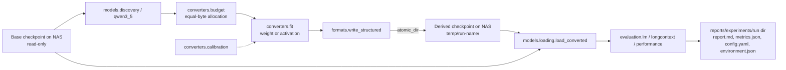

# Repository Guidelines

## Model storage (MANDATORY)

> **All base and derived models must be stored under `/mnt/NAS/MediaHome/Local-Models/`.**

| What | Location |
|---|---|
| NAS root (everything model-sized) | `/mnt/NAS/MediaHome/Local-Models/` |
| Default base location | `/mnt/NAS/MediaHome/Local-Models/base/` |
| Default derived location | `/mnt/NAS/MediaHome/Local-Models/temp/` (one new directory per conversion run) |

- **Never use the project repository for full checkpoints.** Git excludes weights (`.gitignore`), and the repo is not a model store.
- Resolve every path through the centralized storage configuration: `configs/storage.yaml`, loaded with `rotor.storage.load_storage()`. Per-machine overlay: `configs/storage.local.yaml` (gitignored) or the file named by the `ROTOR_STORAGE_CONFIG` environment variable (tests use it to redirect to tmp dirs). **Do not scatter hardcoded absolute paths** in scripts, configs, or code.
- Existing models elsewhere under the NAS root are **referenced in place** via an absolute `local_path` in `configs/models.yaml` / `configs/models.local.yaml`; they are never moved. A relative `local_path` resolves under `base_root`.
- Pre-existing NAS directories (`preexisting_read_only` in `configs/storage.yaml`) are read-only to this project:
  - `/mnt/NAS/MediaHome/Local-Models/Qwen-Image 2.1 Uncensored Q8/`
  - `/mnt/NAS/MediaHome/Local-Models/Qwen3.8-Flash-Next/`
  - `/mnt/NAS/MediaHome/Local-Models/gemma-4-e4b-v2-sol-fable/`
  - `/mnt/NAS/MediaHome/Local-Models/ternary-bonsai-27b/`
- **Never move, overwrite, delete, or duplicate preexisting model weights without explicit permission.**
- `Storage.assert_writable()` already refuses writes into `base_root` and into `preexisting_read_only`; do not bypass it.
- The user authorized conversion outputs under `temp/` on 2026-10-08. Existing outputs remain protected by no-overwrite atomic publishing.

## Safety and bandwidth

- Check for existing files before downloading anything.
- Never overwrite base checkpoints.
- Never download models or large datasets without explicit permission. Header-only remote reads (`rotor.models.discovery.remote_tensors` / `remote_json` / `remote_repo_info`, `scripts/inspect_model.py --remote`) are fine; code in this repo never downloads weights.
- Avoid unnecessary data duplication (derived checkpoints store only replaced projections; untouched tensors stay in the base).
- Record the original model revision and checksums (manifest `base` provenance: HF id, revision, shard SHA-256; `rotor.storage.sha256_file`).
- Write incomplete outputs to temporary files and publish atomically: `rotor.storage.atomic_dir(dest)` for directories, `atomic_write_bytes` for files. Both refuse to overwrite an existing destination.
- Do not put model weights, private datasets, or credentials in Git.
- Do not silently download multiple model variants or unrelated quantizations.

## Research integrity

- Never invent benchmark results. Every number comes from a recorded run or is labeled `estimate`.
- Clearly distinguish actual measurements from theoretical estimates (formula-derived values such as `flops_per_token()` are estimates).
- Compare models using identical token sequences and evaluation settings; prove it with `rotor.data.windows_fingerprint` / the `windows_sha256` that `evaluate_lm` returns.
- Record configuration, dataset, seed, library versions, hardware, and timestamps with `rotor.reporting.ExperimentRun`: every run publishes a directory `reports/experiments/<model>__<method>__<target>__<UTC>/` containing `report.md`, `metrics.json`, `config.yaml`, `environment.json`, `figures/`, `logs/`. Put measured values in `.metrics` and formula-derived values in `.estimates`.
- Failed runs are published too (status `failed`, with traceback); never delete them.
- Compare representations at **equal stored-byte budgets**; report compute separately. Compression targets are presets (fraction of original stored bytes): `b075`=0.75, `b050`=0.50, `b035`=0.35, `b025`=0.25, `b015`=0.15 (`rotor.converters.budget.COMPRESSION_TARGETS`, `parse_target`). Byte accounting is serialized bytes (actual tensor bytes in `rotor_weights.safetensors`; checkpoint totals also report file/manifest/header/index/padding/quantization-metadata bytes).
- Always include the required baselines (`rotor.evaluation.baselines.equal_budget_baselines`): `dense`, truncated SVD (`svd`), SVD→Givens (`svd_givens`), `magnitude_sparse`, `butterfly`, rotor/scaler (`rotor_weight`), rotor/scaler + residual (`rotor_residual`), plus the random controls.
- Long-context evaluation only after short-context behavior matches the reference (`scripts/evaluate_model.py --short-context-verified` asserts it; otherwise refused).

## Development behavior

- Inspect the existing repository before making structural changes.
- Prefer small, independently testable components.
- Do not rewrite the entire inference engine during conversion development.
- Keep Python research components independent of C++ runtime components (the only shared contract is the format spec).
- Run the relevant tests before declaring a milestone complete.
- Explain material architectural changes in `docs/DECISIONS.md`.
- Do not silently relax correctness tolerances.

## Hardware

- Detect the actual CPU, RAM, GPU, CUDA, Vulkan, available storage, and compiler capabilities with `scripts/audit_environment.py` / `rotor.environment.detect_environment()`. Do not assume all listed GPUs are available to every host.
- Record the actual hardware for each benchmark: `ExperimentRun` writes `environment.json` automatically.
- Avoid swap-heavy or accidental CPU-fallback measurements when reporting GPU kernel performance: `scripts/benchmark.py --device cuda` refuses CPU fallback, and `--refuse-swap` fails the run if swap usage grows.
- Current dev host (measured 2026-10-08 by `detect_environment()`): AMD Ryzen 5 7600X (6C/12T; AVX2, AVX-512F, AVX-512 BF16, VNNI), 62 GiB RAM, 8 GiB swap. No NVIDIA GPU on the PCI bus (`nvidia-smi` fails); AMD Radeon RX 7900 XT/XTX (amdgpu, 24 GiB) plus Raphael iGPU; no ROCm; Vulkan loader + radeon ICD only. torch is CPU-only (2.14.1+cpu). `nvcc` 12.0 can compile but not run CUDA here. Compilers: g++ 13.3, clang++ 18.1, cmake 3.28 (no ninja). LaTeX: pdflatex, lualatex, bibtex (no latexmk, biber, xelatex; use natbib/bibtex, not biblatex). Repo on `/mnt/Projects`; NAS via CIFS.

---

## Project overview

Research code testing whether pretrained Transformer linear weights `W (out x in)` admit smaller compositional representations

`W ≈ D_0 R_1 D_1 R_2 D_2 … R_k D_k`

(`R_i` = products of disjoint 2D Givens rotation stages on a deterministic topology `brick | butterfly | seeded`; `D_i` = learned diagonals; rectangular layers via pad/truncate; optional low-rank residual `U V`) than dense coefficients, without large language-model quality loss. This is a hypothesis, not a result: no benchmark results exist in this repo yet.

**Stage:** milestone M0 done (scaffold, storage, math, format v1, converter/eval/training code, C++ reference headers, tiny-model tests). M1–M6 (mathematical prototype, 0.8B conversion, 2B experiments, CUDA kernel prototype, engine integration, scaling/publication) are open; see `docs/ROADMAP.md`. **Scope:** text-only, FFN projections only (`ffn.gate`, `ffn.up`, `ffn.down`); attention, DeltaNet, norms, embeddings, RoPE, MTP, and vision are untouched (`docs/DECISIONS.md` D6).

## Architecture & data flow

Derived checkpoints (`rotor-scaler` format: `rotor_manifest.json`, `rotor_weights.safetensors`, `base_metadata/`) store only replaced projections; the base checkpoint stays authoritative for everything else. See `docs/ARCHITECTURE.md`.

## Key directories

| Path | Contents |
|---|---|
| `src/rotor/math/` | Topologies, Givens stages, `CascadeSpec`/`RotorCascade`/`RotorLinear`, low-rank residual, SVD→Givens decomposition |
| `src/rotor/formats/` | `rotor-scaler` spec constants, `Manifest`, checkpoint write/read |
| `src/rotor/models/` | Header-only discovery, Qwen3.5 adapter, module replacement, loading, tiny test checkpoints |
| `src/rotor/converters/` | Byte-budget allocation, weight/activation fitting, calibration capture, conversion pipeline |
| `src/rotor/evaluation/` | Reconstruction errors, LM NLL/perplexity, long-context buckets, timing, equal-budget baselines |
| `src/rotor/training/` | Optimizer groups, layer-wise fit schedules, recovery distillation |
| `src/rotor/storage.py`, `data.py` | Path resolution and write guards; deterministic token windows and fingerprints |
| `src/rotor/environment.py`, `reporting.py` | Host/hardware detection and resource monitor; `ExperimentRun` run-directory publisher |
| `scripts/` | CLI entry points (thin wrappers over the library) |
| `configs/` | `storage.yaml`, `models.yaml`, `experiments/*.yaml` (schema in `configs/experiments/README.md`), `evaluation/*.yaml` (schema in `configs/evaluation/README.md`) |
| `runtime/` | C++ side: `interfaces/` headers (present); `kernels/`, `fork/` (empty) |
| `tests/` | pytest suite, CPU-only |
| `docs/` | `ARCHITECTURE`, `RESEARCH_PLAN`, `DECISIONS`, `ROADMAP`, `INFERENCE_ENGINE_PLAN` |
| `reports/` | `experiments/<model>__<method>__<target>__<UTC>/` run directories, `templates/`, `figures/`, `papers/` (LaTeX, natbib/bibtex), `literature/` |

## Development commands

Run everything with `.venv/bin/python`. The current dev host has no NVIDIA GPU; everything runs on CPU (see **Hardware**).

| Task | Command |
|---|---|
| Create venv + install | `python3 -m venv .venv && .venv/bin/pip install --index-url https://download.pytorch.org/whl/cpu torch && .venv/bin/pip install -e '.[dev]'` |
| Tests (default; excludes `network`, `nas`) | `.venv/bin/python -m pytest` |
| Network tests (Hub metadata only) | `.venv/bin/python -m pytest -m network` |
| C++ parity tests (needs a C++17 compiler) | `.venv/bin/python -m pytest -m cxx` |
| Lint | `.venv/bin/ruff check src scripts tests` |
| Audit host + NAS layout (read-only) | `.venv/bin/python scripts/audit_environment.py [--json out.json] [--report]` (`--report` publishes a run directory, kind `audit`) |
| Remote header inspection (no download) | `.venv/bin/python scripts/inspect_model.py --remote --model qwen3.5-0.8b` |
| Per-matrix equal-byte comparison (dense, SVD, SVD→Givens, magnitude sparse, butterfly, rotor, rotor+residual, controls) | `.venv/bin/python scripts/compare_baselines.py --synthetic 48,32 --steps 50 --target b025` |
| Conversion plan (fits nothing, writes nothing) | `.venv/bin/python scripts/convert_model.py --config configs/experiments/qwen3.5-0.8b-ffn-weight.yaml --dry-run` |
| Convert (needs the base checkpoint on disk; refuses otherwise) | `.venv/bin/python scripts/convert_model.py --config configs/experiments/qwen3.5-0.8b-ffn-weight.yaml` |
| Weight-space sweep plan | `.venv/bin/python scripts/sweep_compression.py --config configs/experiments/qwen3.5-0.8b-ffn-weight.yaml --targets b050,b025 --dry-run` |
| Evaluate base vs converted on identical windows | `.venv/bin/python scripts/evaluate_model.py --ckpt <derived dir> --compare-base --text-file <approved text> --seq-len 512 --num-windows 16` (`--random-tokens` is smoke only) |
| Evaluate from a config | `.venv/bin/python scripts/evaluate_model.py --config configs/evaluation/qwen3.5-short-context.yaml --ckpt <derived dir>` (CLI flags override YAML) |
| Long-context / passkey evaluation | add `--short-context-verified` (refused otherwise; only after short-context matches the reference) |
| Recovery fine-tuning (KL distillation) | `.venv/bin/python scripts/train_recovery.py --ckpt <derived dir> --text-file <approved text> --steps 200 --out <name>` |
| Linear-layer microbenchmark | `.venv/bin/python scripts/benchmark.py --in 1024 --out 3584 --byte-ratio 0.25 --batch-sizes 1,8` (GPU: `--device cuda`, refuses CPU fallback; `--refuse-swap`) |
| Build the paper PDF (pdflatex + bibtex) | `make -C reports/papers pdf` |

## Code conventions

- Python ≥ 3.11, `from __future__ import annotations`, line length 120, ruff rules `E,F,W,I,B,UP` (`E741` ignored).
- **Dependency rule:** `rotor.math` must not import `rotor.models` or `transformers` (torch/stdlib only). Only `rotor.models` knows checkpoint tensor naming and module paths. `rotor.formats` depends on `math`, not `models`. `converters`/`evaluation`/`training` may use `math`, `formats`, `models`; never the reverse.
- **Format spec:** `src/rotor/formats/spec.py` is normative and mirrored in `runtime/interfaces/rotor_format.h` and `rotor_topology.hpp`. Change both sides in the same change, bump `FORMAT_VERSION`, and update the parity test (`tests/test_cxx_parity.py`, marker `cxx`). Topology changes (pair schedules, SplitMix64 permutation) are format breaks.
- Storage dtypes: float32, bfloat16, float16 (`bytes_per_param`). Budgets are in stored bytes, never parameter counts.
- **Qwen3.5 specifics** (`rotor.models.qwen3_5`): hybrid Gated DeltaNet (`linear_attention`) / gated attention (`full_attention`) layers selected by `layer_types` / `full_attention_interval`; every layer has SwiGLU `mlp.{gate,up,down}_proj`. On-disk tensor names: `model.language_model.*` (text), `mtp.*` (multi-token prediction), `model.visual.*` (vision). Embeddings are tied (no `lm_head.weight`). Text-only load goes through `AutoModelForCausalLM` → `Qwen3_5ForCausalLM`, whose module paths drop `language_model` (`model.layers.N.mlp.up_proj`) and which ignores `mtp.*` and `model.visual.*`. Initial conversion scope: FFN gate/up/down only.
- Anything formula-derived in output/docs is labeled `estimate`.

## Footguns

- `.gitignore` anchors `/models/`, `/checkpoints/`, `/outputs/`, `/runs/`, `/hf_cache/` to the repo root so `src/rotor/models/` stays tracked; keep those entries anchored. It also ignores `*.safetensors`, `*.bin`, `*.pt`, etc. (tiny generated test fixtures are written to tmp dirs, not committed).
- Tiny checkpoints (`rotor.models.tiny.make_tiny_checkpoint`) have no `mtp.*` tensors: `save_pretrained` does not emit them.
- The development host has no NVIDIA GPU and no ROCm (`nvidia-smi` fails); `device` arguments default to CPU. Do not assume CUDA.
- Random-token calibration/evaluation (`calibration.source: random`, `--random-tokens`) is a smoke test only; it says nothing about language-model quality.
- Without `flash-linear-attention` / `causal-conv1d`, `transformers` falls back to slow torch Gated DeltaNet kernels; this affects speed of full-model runs, not correctness. Do not report those timings as performance results.
- `rotor.converters.pipeline.convert` refuses when the base checkpoint is missing and reports the HF id/revision/target path; nothing in the repo fetches weights. Do not "fix" this by adding a downloader.
- Derived output names must not already exist: `atomic_dir` refuses to overwrite. Pick a new `name` instead of deleting.
- bf16 storage is lossy relative to float32; format round-trip tests use a documented tolerance for bfloat16.

## Testing & QA

- Tests are CPU-only, deterministic, and use `tiny_ckpt` (session fixture: random tiny Qwen3.5 checkpoint, hidden 64) and `tmp_storage` (storage rooted in `tmp_path/nas`, sets `ROTOR_STORAGE_CONFIG`) from `tests/conftest.py`. They never touch the real NAS.
- Files: `test_math.py`, `test_formats_storage.py`, `test_qwen_adapter.py`, `test_conversion_integration.py` (tiny end-to-end), `test_evaluation.py`, `test_cxx_parity.py` (`cxx`). `network` tests read Hub metadata only.
- Run `.venv/bin/python -m pytest` and `.venv/bin/ruff check src scripts tests` before declaring a milestone complete; run `-m cxx` after touching `runtime/interfaces/` or `rotor.math.topology`/`formats.spec`.

## Important files

| File | Why it matters |
|---|---|
| `configs/storage.yaml` | Single source of truth for NAS roots and read-only directories |
| `configs/models.yaml` | Target models: HF id, pinned revision, `local_path`, published sizes, shapes |
| `configs/experiments/*.yaml` | Conversion run definitions (`qwen3.5-0.8b-ffn-weight`, `-activation`, `qwen3.5-2b-ffn-weight`) |
| `src/rotor/storage.py` | `load_storage`, `assert_writable`, `atomic_dir`, `atomic_write_bytes`, `sha256_file` |
| `src/rotor/formats/spec.py` | Normative `rotor-scaler` format (`FORMAT_VERSION`) |
| `src/rotor/math/cascade.py` | `CascadeSpec` (param/FLOP accounting), `RotorCascade`, `RotorLinear` |
| `src/rotor/converters/pipeline.py` | `convert(...)`: end-to-end conversion with dry-run |
| `src/rotor/evaluation/baselines.py` | Equal-byte baselines (dense, SVD, SVD→Givens, magnitude sparse, butterfly, rotor, rotor+residual) and random controls |
| `src/rotor/reporting.py` | `ExperimentRun` run-directory publisher, `markdown_table`, `make_run_id`, `flatten` |
| `src/rotor/environment.py` | `detect_environment`, `capability_summary`, `ResourceMonitor` |
| `reports/templates/experiment_report.md` | Template rendered into every run's `report.md` |
| `configs/evaluation/*.yaml` | Evaluation definitions for `scripts/evaluate_model.py --config` (schema: `configs/evaluation/README.md`) |
| `runtime/README.md` | C++ runtime status and rules |
| `docs/RESEARCH_PLAN.md`, `docs/DECISIONS.md`, `docs/ROADMAP.md` | Hypothesis and falsification criteria; ADRs D1–D10; milestones M0–M6 |
