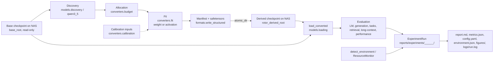

# Architecture

## Package layout

```
src/rotor/
  storage.py       NAS path resolution, write guards, atomic publish, sha256
  environment.py   measured host/software capability detection and resource monitoring
  reporting.py     atomic experiment run directories, metrics/estimates, logs and figures
  data.py          tokenization, deterministic token windows, window fingerprints
  math/            topology, Givens stages, RotorCascade/RotorLinear, low-rank residual, SVD→Givens decomposition
    butterfly.py   classic learned butterfly factorization
    sparse.py      magnitude-pruned sparse baseline
  formats/         rotor-scaler derived checkpoint format: spec constants, Manifest, write/read
  models/          checkpoint discovery (header-only), Qwen3.5 adapter, module replacement, loading, tiny test checkpoints
  converters/      budget allocation, weight/activation fitting, calibration, conversion pipeline
  evaluation/      reconstruction, LM, long-context, performance, baselines, generation, tasks, retrieval
  training/        optimizer groups, layerwise fit schedules, recovery distillation
scripts/           CLI entry points (table below)
runtime/           native runtime (interfaces/ header mirrors of the format and topology, kernels/, fork/); independent of Python
tests/             pytest suite (CPU-only; markers: slow, network, nas, cxx)
configs/           storage.yaml, models.yaml, experiments/*.yaml, evaluation/
reports/            templates/ (experiment report), experiments/ (published run directories), papers/
```
docs/              architecture, research plan, decisions and roadmap

### Dependency rules

- `rotor.math` imports only `torch`/stdlib: **no** `transformers`, no model or checkpoint concepts.
- `rotor.models` is the **only** place that knows checkpoint tensor names and module paths
  (`model.language_model.layers.N.mlp.up_proj.weight` on disk, `model.layers.N.mlp.up_proj` in the loaded model).
- `rotor.formats` depends on `math`, not on `models`; model-specific names enter only as opaque module strings.
- `rotor.converters`, `rotor.evaluation`, `rotor.training` may use `math`, `formats`, `models`; `math` and `formats` never import them.
- `runtime/` implements the format in C++ and does not depend on Python; the normative semantics live in
  `src/rotor/formats/spec.py` (mirrored by `runtime/interfaces/rotor_format.h`).
- Paths come only from `rotor.storage.load_storage()`; scripts never hardcode locations.

## Data flow



Each run directory is published by `rotor.reporting.ExperimentRun`; `ROTOR_REPORTS_DIR` overrides the reports root.
Failed runs are published with status `failed` before exceptions propagate. Formula-derived values are estimates and remain
separate from measured metrics.

The base checkpoint is hashed (sha256 of shards) into manifest provenance; untouched tensors are always read from the
base, so base weights are never duplicated. Conversion refuses if the base is missing and reports the exact HF id,
revision and target path to fetch; nothing is downloaded automatically.

## Derived checkpoint format

Name `rotor-scaler`, version `FORMAT_VERSION` (1). A derived checkpoint directory contains `rotor_manifest.json`
(`Manifest`: base provenance, per-layer `LayerEntry` with spec/dtype/param and byte counts/metrics, conversion config,
environment, notes), `rotor_weights.safetensors` (per module: `angles`, `d_in`, `d_mid`, `d_out`, optional `residual.U`,
`residual.V`, `bias`), and `base_metadata/` (small base files). **`src/rotor/formats/spec.py` is normative** for
tensor keys and for the forward semantics (`y = D_0 * P(R_1 D_1 … R_k E(D_k x)) + U(Vx) + bias`). Allowed storage
dtypes: float32, bfloat16, float16 (`bytes_per_param`).

## Storage and safety mechanisms

- Everything model-sized lives under `nas_root` (`/mnt/NAS/MediaHome/Local-Models/`): base in `base_root`, derived in
  `rotor_derived_root` (`derived/rotor-scaler/`). Configured in `configs/storage.yaml`; override with
  `configs/storage.local.yaml` (gitignored) or `ROTOR_STORAGE_CONFIG` (tests use this to redirect to tmp dirs).
- `Storage.validate()` rejects roots outside `nas_root`; `assert_under_nas(p)` rejects other paths.
- `Storage.assert_writable(p)` refuses writes into `base_root` and into any `preexisting_read_only` directory
  (existing Qwen-Image, Qwen3.8-Flash-Next, gemma-4, ternary-bonsai-27b, temp contents).
- `Storage.derived_path(*parts)` returns a destination already checked by `assert_writable`.
- `atomic_dir(dest)` builds output in a temp directory and renames into place; it refuses to overwrite an existing
  destination. `atomic_write_bytes` does the same for single files.
- Weights and datasets are never downloaded by code; remote access is header-only HTTP range reads
  (`remote_tensors`, `remote_json`, `remote_repo_info`).
- Tests use `make_tiny_checkpoint` and tmp storage; no NAS access required (`nas` marker for tests that need it).

## Entry points

All CLIs live in `scripts/` and are run as `.venv/bin/python scripts/<name>.py …`. Derived checkpoints are written under
`rotor_derived_root` via `atomic_dir`; experiment runs use `ExperimentRun` under `reports/experiments/` (or the root
overridden by `ROTOR_REPORTS_DIR`).

| Script | Purpose | Key flags | Writes |
|---|---|---|---|
| `inspect_model.py` | Tensor groups, layer types, FFN projections of a base checkpoint (local, or header-only with `--remote`) | `--model`, `--base-dir`, `--remote`, `--checksums`, `--json`, `--record` | optional JSON; run directory with `--record` |
| `convert_model.py` | Fit FFN projections into rotor-cascade form from experiment YAML | `--config` (required), `--base-dir`, `--out`, `--name`, `--layers`, `--steps-scale`, `--target`, `--dry-run`, `--no-report` | derived checkpoint; report run unless `--no-report`; dry run prints plan only |
| `evaluate_model.py` | NLL/perplexity, generation, multiple-choice and synthetic passkey retrieval | `--config`, `--base-dir`, `--model`, `--ckpt`, `--text-file`, `--random-tokens`, `--seq-len`, `--num-windows`, `--seed`, `--device`, `--dtype`, `--batch-size`, `--long-context-buckets`, `--generation-prompt-tokens`, `--max-new-tokens`, `--mc-jsonl`, `--passkey`, `--passkey-context`, `--max-context`, `--short-context-verified`, `--compare-base`, `--name` | report run directory |
| `sweep_compression.py` | Weight-space equal-byte sweep over selected FFN tensors | `--config` (required), `--base-dir`, `--byte-ratios` or `--targets` or `--target`, `--topologies`, `--residual-ranks`, `--layers`, `--max-tensors`, `--steps-scale`, `--dry-run`, `--name` | report run directory; dry-run plans only |
| `compare_baselines.py` | Per-matrix comparison: dense, truncated SVD, SVD→Givens, magnitude sparse, butterfly, rotor variants and controls | exactly one of `--base-dir`, `--model`, `--synthetic IN,OUT`; `--tensors`, `--max-tensors`, `--byte-ratio` or `--target`, `--storage-dtype`, `--topology`, `--topology-seed`, `--stages-per-rotor`, `--residual-rank`, `--steps`, `--lr-angles`, `--lr-scales`, `--lr-residual`, `--with-activations`, `--text-file`, `--seq-len`, `--num-windows`, `--max-rows`, `--seed`, `--name` | report run directory |
| `benchmark.py` | Microbenchmark dense `nn.Linear` vs `RotorLinear` vs `LowRankLinear` at equal stored bytes | `--in`, `--out`, `--model`, `--family`, `--byte-ratio`, `--batch-sizes`, `--topology`, `--stages-per-rotor`, `--residual-rank`, `--device`, `--dtype`, `--seed`, `--refuse-swap` / `--no-refuse-swap` | report run directory |
| `train_recovery.py` | KL-distillation recovery of a converted checkpoint; trains only `RotorLinear` parameters | `--ckpt` and `--out` (required), exactly one of `--text-file`/`--random-tokens`, `--seq-len`, `--num-windows`, `--steps`, `--batch-size`, `--lr-angles`, `--lr-scales`, `--lr-residual`, `--temperature`, `--ce-weight`, `--grad-clip`, `--log-every`, `--seed`, `--device` | recovered derived checkpoint and report run |
| `audit_environment.py` | Read-only host capability and NAS-layout audit | `--json`, `--report` | optional JSON; report run with `--report` |

Experiment YAMLs for `convert_model.py` / `sweep_compression.py` are in `configs/experiments/`; evaluation YAMLs are in
`configs/evaluation/`. Report templates live in `reports/templates/`, and paper sources/materials in `reports/papers/`.

Library entry points: `rotor.environment.detect_environment`, `capability_summary`, `ResourceMonitor`; `rotor.reporting.ExperimentRun`,
`markdown_table`, `make_run_id`, `flatten`; `rotor.converters.pipeline.convert`, `converters.budget.allocate`,
`converters.fit.fit_weight/fit_activation`; `evaluation.baselines.equal_budget_baselines`,
`evaluation.lm.evaluate_lm`, `evaluation.longcontext.nll_by_position`, `evaluation.performance.linear_microbench`,
`evaluation.generation.greedy_decode/measure_generation/compare_generations`,
`evaluation.tasks.load_jsonl_items/continuation_loglik/multiple_choice_accuracy`,
`evaluation.retrieval.passkey_items/passkey_accuracy`; `models.loading.load_base/load_converted`,
`training.recovery.train_recovery/export_recovered`, `models.discovery.remote_tensors/local_tensors`.
```

### Dependency rules

- `rotor.math` imports only `torch`/stdlib: **no** `transformers`, no model or checkpoint concepts.
- `rotor.models` is the **only** place that knows checkpoint tensor names and module paths
  (`model.language_model.layers.N.mlp.up_proj.weight` on disk, `model.layers.N.mlp.up_proj` in the loaded model).
- `rotor.formats` depends on `math`, not on `models`; model-specific names enter only as opaque module strings.
- `rotor.converters`, `rotor.evaluation`, `rotor.training` may use `math`, `formats`, `models`; `math` and `formats` never import them.
- `runtime/` implements the format in C++ and does not depend on Python; the normative semantics live in
  `src/rotor/formats/spec.py` (mirrored by `runtime/interfaces/rotor_format.h`).
- Paths come only from `rotor.storage.load_storage()`; scripts never hardcode locations.

## Data flow


Each run directory is published by `rotor.reporting.ExperimentRun`; `ROTOR_REPORTS_DIR` overrides the reports root.
Failed runs are published with status `failed` before exceptions propagate. Formula-derived values are estimates and remain
separate from measured metrics.

The base checkpoint is hashed (sha256 of shards) into manifest provenance; untouched tensors are always read from the
base, so base weights are never duplicated. Conversion refuses if the base is missing and reports the exact HF id,
revision and target path to fetch; nothing is downloaded automatically.

## Derived checkpoint format

Name `rotor-scaler`, version `FORMAT_VERSION` (1). A derived checkpoint directory contains `rotor_manifest.json`
(`Manifest`: base provenance, per-layer `LayerEntry` with spec/dtype/param and byte counts/metrics, conversion config,
environment, notes), `rotor_weights.safetensors` (per module: `angles`, `d_in`, `d_mid`, `d_out`, optional `residual.U`,
`residual.V`, `bias`), and `base_metadata/` (small base files). **`src/rotor/formats/spec.py` is normative** for
tensor keys and for the forward semantics (`y = D_0 * P(R_1 D_1 … R_k E(D_k x)) + U(Vx) + bias`). Allowed storage
dtypes: float32, bfloat16, float16 (`bytes_per_param`).

## Storage and safety mechanisms

- Everything model-sized lives under `nas_root` (`/mnt/NAS/MediaHome/Local-Models/`): base in `base_root`, derived in
  `rotor_derived_root` (`derived/rotor-scaler/`). Configured in `configs/storage.yaml`; override with
  `configs/storage.local.yaml` (gitignored) or `ROTOR_STORAGE_CONFIG` (tests use this to redirect to tmp dirs).
- `Storage.validate()` rejects roots outside `nas_root`; `assert_under_nas(p)` rejects other paths.
- `Storage.assert_writable(p)` refuses writes into `base_root` and into any `preexisting_read_only` directory
  (existing Qwen-Image, Qwen3.8-Flash-Next, gemma-4, ternary-bonsai-27b, temp contents).
- `Storage.derived_path(*parts)` returns a destination already checked by `assert_writable`.
- `atomic_dir(dest)` builds output in a temp directory and renames into place; it refuses to overwrite an existing
  destination. `atomic_write_bytes` does the same for single files.
- Weights and datasets are never downloaded by code; remote access is header-only HTTP range reads
  (`remote_tensors`, `remote_json`, `remote_repo_info`).
- Tests use `make_tiny_checkpoint` and tmp storage; no NAS access required (`nas` marker for tests that need it).

## Entry points

All CLIs live in `scripts/` and are run as `.venv/bin/python scripts/<name>.py …`. Derived checkpoints are written under
`rotor_derived_root` via `atomic_dir`; experiment runs use `ExperimentRun` under `reports/experiments/` (or the root
overridden by `ROTOR_REPORTS_DIR`).

| Script | Purpose | Key flags | Writes |
|---|---|---|---|
| `inspect_model.py` | Tensor groups, layer types, FFN projections of a base checkpoint (local, or header-only with `--remote`) | `--model`, `--base-dir`, `--remote`, `--checksums`, `--json`, `--record` | optional JSON; run directory with `--record` |
| `convert_model.py` | Fit FFN projections into rotor-cascade form from experiment YAML | `--config` (required), `--base-dir`, `--out`, `--name`, `--layers`, `--steps-scale`, `--target`, `--dry-run`, `--no-report` | derived checkpoint; report run unless `--no-report`; dry run prints plan only |
| `evaluate_model.py` | NLL/perplexity, generation, multiple-choice and synthetic passkey retrieval | `--config`, `--base-dir`, `--model`, `--ckpt`, `--text-file`, `--random-tokens`, `--seq-len`, `--num-windows`, `--seed`, `--device`, `--dtype`, `--batch-size`, `--long-context-buckets`, `--generation-prompt-tokens`, `--max-new-tokens`, `--mc-jsonl`, `--passkey`, `--passkey-context`, `--max-context`, `--short-context-verified`, `--compare-base`, `--name` | report run directory |
| `sweep_compression.py` | Weight-space equal-byte sweep over selected FFN tensors | `--config` (required), `--base-dir`, `--byte-ratios` or `--targets` or `--target`, `--topologies`, `--residual-ranks`, `--layers`, `--max-tensors`, `--steps-scale`, `--dry-run`, `--name` | report run directory; dry-run plans only |
| `compare_baselines.py` | Per-matrix comparison: dense, truncated SVD, SVD→Givens, magnitude sparse, butterfly, rotor variants and controls | exactly one of `--base-dir`, `--model`, `--synthetic IN,OUT`; `--tensors`, `--max-tensors`, `--byte-ratio` or `--target`, `--storage-dtype`, `--topology`, `--topology-seed`, `--stages-per-rotor`, `--residual-rank`, `--steps`, `--lr-angles`, `--lr-scales`, `--lr-residual`, `--with-activations`, `--text-file`, `--seq-len`, `--num-windows`, `--max-rows`, `--seed`, `--name` | report run directory |
| `benchmark.py` | Microbenchmark dense `nn.Linear` vs `RotorLinear` vs `LowRankLinear` at equal stored bytes | `--in`, `--out`, `--model`, `--family`, `--byte-ratio`, `--batch-sizes`, `--topology`, `--stages-per-rotor`, `--residual-rank`, `--device`, `--dtype`, `--seed`, `--refuse-swap` / `--no-refuse-swap` | report run directory |
| `train_recovery.py` | KL-distillation recovery of a converted checkpoint; trains only `RotorLinear` parameters | `--ckpt` and `--out` (required), exactly one of `--text-file`/`--random-tokens`, `--seq-len`, `--num-windows`, `--steps`, `--batch-size`, `--lr-angles`, `--lr-scales`, `--lr-residual`, `--temperature`, `--ce-weight`, `--grad-clip`, `--log-every`, `--seed`, `--device` | recovered derived checkpoint and report run |
| `audit_environment.py` | Read-only host capability and NAS-layout audit | `--json`, `--report` | optional JSON; report run with `--report` |

Experiment YAMLs for `convert_model.py` / `sweep_compression.py` are in `configs/experiments/`; evaluation YAMLs are in
`configs/evaluation/`. Report templates live in `reports/templates/`, and paper sources/materials in `reports/papers/`.

Library entry points: `rotor.environment.detect_environment`, `capability_summary`, `ResourceMonitor`; `rotor.reporting.ExperimentRun`,
`markdown_table`, `make_run_id`, `flatten`; `rotor.converters.pipeline.convert`, `converters.budget.allocate`,
`converters.fit.fit_weight/fit_activation`; `evaluation.baselines.equal_budget_baselines`,
`evaluation.lm.evaluate_lm`, `evaluation.longcontext.nll_by_position`, `evaluation.performance.linear_microbench`,
`evaluation.generation.greedy_decode/measure_generation/compare_generations`,
`evaluation.tasks.load_jsonl_items/continuation_loglik/multiple_choice_accuracy`,
`evaluation.retrieval.passkey_items/passkey_accuracy`; `models.loading.load_base/load_converted`,
`training.recovery.train_recovery/export_recovered`, `models.discovery.remote_tensors/local_tensors`.
## Derived checkpoint format

Name `rotor-scaler`, version `FORMAT_VERSION` (1). A derived checkpoint directory contains `rotor_manifest.json`
(`Manifest`: base provenance, per-layer `LayerEntry` with spec/dtype/param and byte counts/metrics, conversion config,
environment, notes), `rotor_weights.safetensors` (per module: `angles`, `d_in`, `d_mid`, `d_out`, optional `residual.U`,
`residual.V`, `bias`), and `base_metadata/` (small base files). **`src/rotor/formats/spec.py` is normative** for
tensor keys and for the forward semantics (`y = D_0 * P(R_1 D_1 … R_k E(D_k x)) + U(Vx) + bias`). Allowed storage
dtypes: float32, bfloat16, float16 (`bytes_per_param`).

## Storage and safety mechanisms

- Everything model-sized lives under `nas_root` (`/mnt/NAS/MediaHome/Local-Models/`): base in `base_root`, derived in
  `rotor_derived_root` (`derived/rotor-scaler/`). Configured in `configs/storage.yaml`; override with
  `configs/storage.local.yaml` (gitignored) or `ROTOR_STORAGE_CONFIG` (tests use this to redirect to tmp dirs).
- `Storage.validate()` rejects roots outside `nas_root`; `assert_under_nas(p)` rejects other paths.
- `Storage.assert_writable(p)` refuses writes into `base_root` and into any `preexisting_read_only` directory
  (existing Qwen-Image, Qwen3.8-Flash-Next, gemma-4, ternary-bonsai-27b, temp contents).
- `Storage.derived_path(*parts)` returns a destination already checked by `assert_writable`.
- `atomic_dir(dest)` builds output in a temp directory and renames into place; it refuses to overwrite an existing
  destination. `atomic_write_bytes` does the same for single files.
- Weights and datasets are never downloaded by code; remote access is header-only HTTP range reads
  (`remote_tensors`, `remote_json`, `remote_repo_info`).
- Tests use `make_tiny_checkpoint` and tmp storage; no NAS access required (`nas` marker for tests that need it).

## Entry points

All CLIs live in `scripts/` and are run as `.venv/bin/python scripts/<name>.py …`. Derived checkpoints are written under
`rotor_derived_root` via `atomic_dir`; experiment runs use `ExperimentRun` under `reports/experiments/` (or the root
overridden by `ROTOR_REPORTS_DIR`).

| Script | Purpose | Key flags | Writes |
|---|---|---|---|
| `inspect_model.py` | Tensor groups, layer types, FFN projections of a base checkpoint (local, or header-only with `--remote`) | `--model`, `--base-dir`, `--remote`, `--checksums`, `--json`, `--record` | optional JSON; run directory with `--record` |
| `convert_model.py` | Fit FFN projections into rotor-cascade form from experiment YAML | `--config` (required), `--base-dir`, `--out`, `--name`, `--layers`, `--steps-scale`, `--target`, `--dry-run`, `--no-report` | derived checkpoint; report run unless `--no-report`; dry run prints plan only |
| `evaluate_model.py` | NLL/perplexity, generation, multiple-choice and synthetic passkey retrieval | `--config`, `--base-dir`, `--model`, `--ckpt`, `--text-file`, `--random-tokens`, `--seq-len`, `--num-windows`, `--seed`, `--device`, `--dtype`, `--batch-size`, `--long-context-buckets`, `--generation-prompt-tokens`, `--max-new-tokens`, `--mc-jsonl`, `--passkey`, `--passkey-context`, `--max-context`, `--short-context-verified`, `--compare-base`, `--name` | report run directory |
| `sweep_compression.py` | Weight-space equal-byte sweep over selected FFN tensors | `--config` (required), `--base-dir`, `--byte-ratios` or `--targets` or `--target`, `--topologies`, `--residual-ranks`, `--layers`, `--max-tensors`, `--steps-scale`, `--dry-run`, `--name` | report run directory; dry-run plans only |
| `compare_baselines.py` | Per-matrix comparison: dense, truncated SVD, SVD→Givens, magnitude sparse, butterfly, rotor variants and controls | exactly one of `--base-dir`, `--model`, `--synthetic IN,OUT`; `--tensors`, `--max-tensors`, `--byte-ratio` or `--target`, `--storage-dtype`, `--topology`, `--topology-seed`, `--stages-per-rotor`, `--residual-rank`, `--steps`, `--lr-angles`, `--lr-scales`, `--lr-residual`, `--with-activations`, `--text-file`, `--seq-len`, `--num-windows`, `--max-rows`, `--seed`, `--name` | report run directory |
| `benchmark.py` | Microbenchmark dense `nn.Linear` vs `RotorLinear` vs `LowRankLinear` at equal stored bytes | `--in`, `--out`, `--model`, `--family`, `--byte-ratio`, `--batch-sizes`, `--topology`, `--stages-per-rotor`, `--residual-rank`, `--device`, `--dtype`, `--seed`, `--refuse-swap` / `--no-refuse-swap` | report run directory |
| `train_recovery.py` | KL-distillation recovery of a converted checkpoint; trains only `RotorLinear` parameters | `--ckpt` and `--out` (required), exactly one of `--text-file`/`--random-tokens`, `--seq-len`, `--num-windows`, `--steps`, `--batch-size`, `--lr-angles`, `--lr-scales`, `--lr-residual`, `--temperature`, `--ce-weight`, `--grad-clip`, `--log-every`, `--seed`, `--device` | recovered derived checkpoint and report run |
| `audit_environment.py` | Read-only host capability and NAS-layout audit | `--json`, `--report` | optional JSON; report run with `--report` |

Experiment YAMLs for `convert_model.py` / `sweep_compression.py` are in `configs/experiments/`; evaluation YAMLs are in
`configs/evaluation/`. Report templates live in `reports/templates/`, and paper sources/materials in `reports/papers/`.

Library entry points: `rotor.environment.detect_environment`, `capability_summary`, `ResourceMonitor`; `rotor.reporting.ExperimentRun`,
`markdown_table`, `make_run_id`, `flatten`; `rotor.converters.pipeline.convert`, `converters.budget.allocate`,
`converters.fit.fit_weight/fit_activation`; `evaluation.baselines.equal_budget_baselines`,
`evaluation.lm.evaluate_lm`, `evaluation.longcontext.nll_by_position`, `evaluation.performance.linear_microbench`,
`evaluation.generation.greedy_decode/measure_generation/compare_generations`,
`evaluation.tasks.load_jsonl_items/continuation_loglik/multiple_choice_accuracy`,
`evaluation.retrieval.passkey_items/passkey_accuracy`; `models.loading.load_base/load_converted`,
`training.recovery.train_recovery/export_recovered`, `models.discovery.remote_tensors/local_tensors`.
