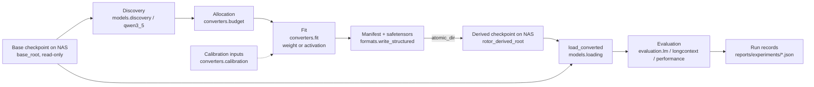

# Architecture

## Package layout

```
src/rotor/
  storage.py       NAS path resolution, write guards, atomic publish, sha256
  data.py          tokenization, deterministic token windows, window fingerprints
  math/            topology, Givens stages, RotorCascade/RotorLinear, low-rank residual, SVD→Givens decomposition
  formats/         rotor-scaler derived checkpoint format: spec constants, Manifest, write/read
  models/          checkpoint discovery (header-only), Qwen3.5 adapter, module replacement, loading, tiny test checkpoints
  converters/      budget allocation, weight/activation fitting, calibration, conversion pipeline
  evaluation/      reconstruction metrics, LM NLL/perplexity, long-context, performance, equal-budget baselines, run records
  training/        optimizer groups, layerwise fit schedules, recovery distillation
scripts/           CLI entry points (table below)
runtime/           native runtime (interfaces/ header mirrors of the format and topology, kernels/, fork/); independent of Python
tests/             pytest suite (CPU-only; markers: slow, network, nas, cxx)
configs/           storage.yaml, models.yaml, experiments/*.yaml
docs/              this document, RESEARCH_PLAN.md
reports/experiments/   JSON run records (environment + timestamp)
```

### Dependency rules

- `rotor.math` imports only `torch`/stdlib: **no** `transformers`, no model or checkpoint concepts.
- `rotor.models` is the **only** place that knows checkpoint tensor names and module paths
  (`model.language_model.layers.N.mlp.up_proj.weight` on disk, `model.layers.N.mlp.up_proj` in the loaded model).
- `rotor.formats` depends on `math`, not on `models`; model-specific names enter only as opaque module strings.
- `rotor.converters`, `rotor.evaluation`, `rotor.training` may use `math`, `formats`, `models`; `math` and `formats` never import them.
- `runtime/` implements the format in C++ and does not depend on Python; the normative semantics live in
  `src/rotor/formats/spec.py` (mirrored by `runtime/interfaces/rotor_format.h`).
- Paths come only from `rotor.storage.load_storage()`; scripts never hardcode locations.

## Data flow



The base checkpoint is hashed (sha256 of shards) into manifest provenance; untouched tensors are always read from the
base, so base weights are never duplicated. Conversion refuses if the base is missing and reports the exact HF id,
revision and target path to fetch; nothing is downloaded automatically.

## Derived checkpoint format

Name `rotor-scaler`, version `FORMAT_VERSION` (1). A derived checkpoint directory contains `rotor_manifest.json`
(`Manifest`: base provenance, per-layer `LayerEntry` with spec/dtype/param and byte counts/metrics, conversion config,
environment, notes), `rotor_weights.safetensors` (per module: `angles`, `d_in`, `d_mid`, `d_out`, optional `residual.U`,
`residual.V`, `bias`), and `base_metadata/` (small base files). **`src/rotor/formats/spec.py` is normative** for
tensor keys and for the forward semantics (`y = D_0 * P(R_1 D_1 … R_k E(D_k x)) + U(Vx) + bias`). Allowed storage
dtypes: float32, bfloat16, float16 (`bytes_per_param`).

## Storage and safety mechanisms

- Everything model-sized lives under `nas_root` (`/mnt/NAS/MediaHome/Local-Models/`): base in `base_root`, derived in
  `rotor_derived_root` (`derived/rotor-scaler/`). Configured in `configs/storage.yaml`; override with
  `configs/storage.local.yaml` (gitignored) or `ROTOR_STORAGE_CONFIG` (tests use this to redirect to tmp dirs).
- `Storage.validate()` rejects roots outside `nas_root`; `assert_under_nas(p)` rejects other paths.
- `Storage.assert_writable(p)` refuses writes into `base_root` and into any `preexisting_read_only` directory
  (existing Qwen-Image, Qwen3.8-Flash-Next, gemma-4, ternary-bonsai-27b, temp contents).
- `Storage.derived_path(*parts)` returns a destination already checked by `assert_writable`.
- `atomic_dir(dest)` builds output in a temp directory and renames into place; it refuses to overwrite an existing
  destination. `atomic_write_bytes` does the same for single files.
- Weights and datasets are never downloaded by code; remote access is header-only HTTP range reads
  (`remote_tensors`, `remote_json`, `remote_repo_info`).
- Tests use `make_tiny_checkpoint` and tmp storage; no NAS access required (`nas` marker for tests that need it).

## Entry points

All CLIs live in `scripts/` and are run as `.venv/bin/python scripts/<name>.py …`. Paths are resolved through
`rotor.storage`; derived checkpoints are written under `rotor_derived_root` via `atomic_dir`, run records under
`reports/experiments/` via `write_run_record` (environment + timestamp).

| Script | Purpose | Key flags | Writes |
|---|---|---|---|
| `inspect_model.py` | Tensor groups, layer types, FFN projections of a base checkpoint (local, or header-only with `--remote`) | `--model`, `--base-dir`, `--remote`, `--checksums`, `--json PATH`, `--record` | optional JSON (`--json`); run record kind `inspect` (`--record`) |
| `convert_model.py` | Fit FFN projections into rotor-cascade form from an experiment YAML (E2–E4 inputs) | `--config` (required), `--base-dir`, `--out`, `--name`, `--layers`, `--steps-scale`, `--dry-run` | derived checkpoint at `rotor_derived_root/<name>` (or `--out`, still atomic and write-guarded); `--dry-run` prints the byte plan and fits nothing |
| `evaluate_model.py` | Next-token NLL / perplexity of a base or converted model on identical windows | `--model`/`--base-dir`, `--ckpt`, `--text-file` or `--random-tokens` (smoke only), `--seq-len`, `--num-windows`, `--seed`, `--device`, `--dtype`, `--batch-size`, `--long-context-buckets`, `--compare-base`, `--name` | run record kind `evaluate` |
| `sweep_compression.py` | Weight-space equal-stored-bytes sweep (SVD vs rotor vs random controls) over byte ratios, topologies, residual ranks (E2) | `--config` (required), `--base-dir`, `--byte-ratios`, `--topologies`, `--residual-ranks`, `--layers`, `--max-tensors`, `--steps-scale`, `--dry-run`, `--name` | run record kind `sweep` |
| `compare_baselines.py` | Per-matrix equal-byte comparison: truncated SVD, SVD→Givens, rotor fits, spectrum-matched and Gaussian controls (E2/E3) | `--model`/`--base-dir`/`--synthetic IN,OUT`, `--tensors` (regex), `--max-tensors`, `--byte-ratio`, `--storage-dtype`, `--topology`, `--stages-per-rotor`, `--residual-rank`, `--steps`, `--with-activations`, `--text-file`, `--seed`, `--name` | run record kind `baselines` |
| `benchmark.py` | Microbenchmark dense `nn.Linear` vs `RotorLinear` vs low-rank linear at equal stored bytes; compute reported separately (E7) | `--in`/`--out` or `--model` + `--family`, `--byte-ratio`, `--batch-sizes`, `--topology`, `--stages-per-rotor`, `--residual-rank`, `--device`, `--dtype`, `--seed` | run record kind `benchmark` |
| `train_recovery.py` | KL-distillation recovery of a converted checkpoint from the dense base; trains only `RotorLinear` parameters (E5) | `--ckpt` (required), `--text-file` or `--random-tokens` (smoke only), `--seq-len`, `--num-windows`, `--steps`, `--lr-angles`, `--lr-scales`, `--lr-residual`, `--temperature`, `--ce-weight`, `--grad-clip`, `--seed`, `--device`, `--out` (required) | recovered derived checkpoint (`--out` is a name under `rotor_derived_root`, or a directory); run record kind `recovery` |

Experiment YAMLs for `convert_model.py` / `sweep_compression.py` are in `configs/experiments/`
(`qwen3.5-0.8b-ffn-weight.yaml`, `qwen3.5-0.8b-ffn-activation.yaml`, `qwen3.5-2b-ffn-weight.yaml`; see its `README.md`).

Library entry points behind the scripts: `rotor.converters.pipeline.convert`, `converters.budget.allocate`,
`converters.fit.fit_weight/fit_activation`, `evaluation.baselines.equal_budget_baselines`,
`models.loading.load_base/load_converted`, `evaluation.lm.evaluate_lm`, `evaluation.longcontext.nll_by_position`,
`evaluation.performance.linear_microbench`, `training.recovery.train_recovery/export_recovered`,
`models.discovery.remote_tensors/local_tensors`, `evaluation.records.write_run_record`.
