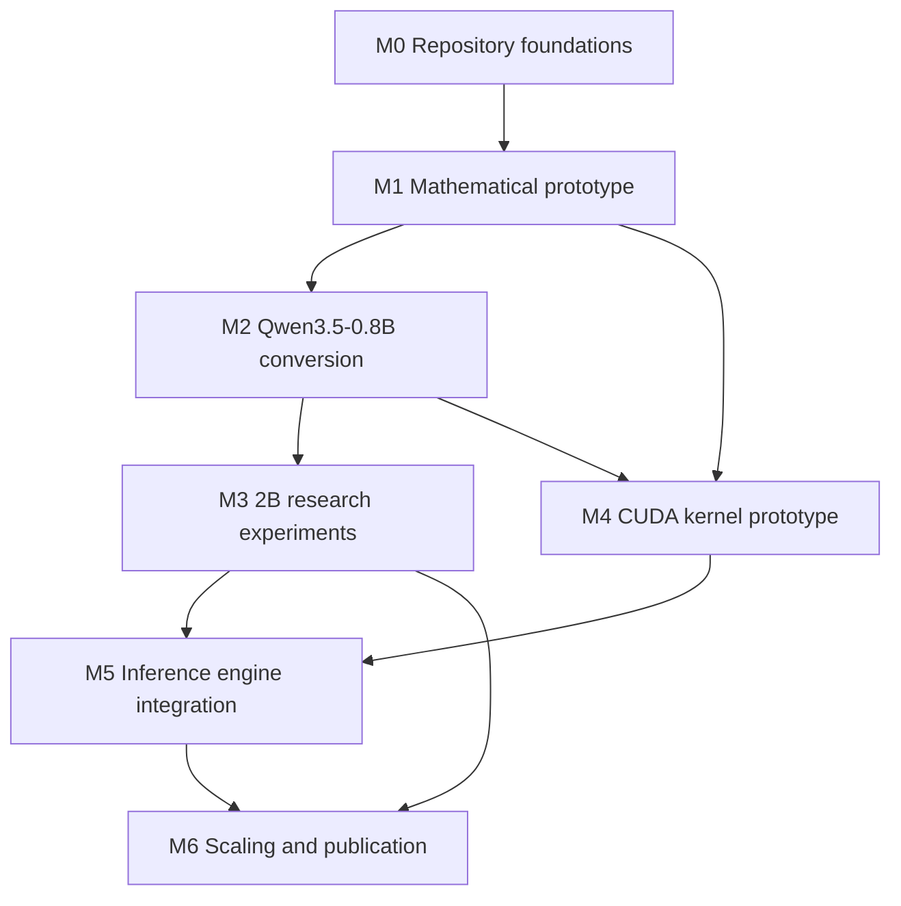

# Rotor Transformer Roadmap

Initial scope is text-only Qwen FFN projections (`gate`, `up`, `down`); attention, Gated DeltaNet, norms, embeddings, RoPE, MTP, and vision remain untouched. Estimated effort ranges below are planning estimates in person-days, not measured durations. Status refers to repository evidence as of this roadmap revision.

**Global gates:** No Qwen checkpoint download without explicit user permission. No inference-engine fork before the M4 correctness/performance gate and engine assessment. Run short-context checks first; long-context evaluation starts only after short-context behavior matches the reference runtime on identical token windows and settings. Formula-derived results and all effort ranges are estimates, never measurements.

---

## M0 — Repository foundations

**Goal:** Establish repository, packaging, configuration, documentation, reporting, tests, and measured environment/storage foundations without modifying checkpoints.

**Deliverables:** Repository/package layout; `AGENTS.md`; `pyproject.toml`; centralized `configs/` and model/storage configuration; storage-safe APIs; experiment configurations and report template; test fixtures/framework; environment detection/reporting; documentation including architecture, research, and engine plans; CPU-only host and NAS audit. No checkpoint download or mutation.

**Dependencies:** None.

**Risks:** NAS CIFS throughput may constrain later checkpoint reads/writes; recording storage capacity does not establish checkpoint IO throughput. Host capabilities can be mistaken for available CUDA execution (this host has no NVIDIA GPU and CPU-only torch). Repository configuration or report templates may drift from actual code contracts.

**Acceptance tests / gates:** `tests/test_formats_storage.py`, `tests/test_conversion_integration.py`, `tests/test_evaluation.py`, `tests/test_qwen_adapter.py`, `tests/test_cxx_parity.py`; `pytest -q` on CPU. Confirm configs, report template, and test fixtures are present; environment record identifies GPU/backend facts; no checkpoint files are modified. Any NAS throughput figure must be measured and kept distinct from estimates.

**Estimated engineering effort:** 3–6 person-days (estimate).

**Status:** Substantially in place by repository inspection: package, configs, docs, scripts, reports/templates, environment and reporting modules, tests, and runtime interfaces exist. Remaining foundation gate is a deliberate environment/NAS audit with measured throughput where needed; no such throughput result is claimed here.

---

## M1 — Mathematical prototype

**Goal:** Establish a small CPU/PyTorch full-rank rotor/scaler operator with deterministic topology and documented numerical behavior.

**Deliverables:** Rotor/scaler cascade and rectangular pad/truncate behavior; deterministic brick, butterfly, and seeded topology; identity/scaling/known-rotation behavior; gradients; serialization; float32 and reduced-precision numerical characterization; residual/baseline math kept distinguishable from full-rank rotor claims.

**Dependencies:** M0.

**Risks:** A fixed butterfly topology may have insufficient expressivity for target matrices; bf16 rounding of angles/parameters can materially perturb outputs; parameter-count or angle-count metrics alone can misstate serialized storage; tests might establish algebraic correctness without testing serialized round trips.

**Acceptance tests / gates:** `tests/test_math.py` and `tests/test_formats_storage.py` (`pytest -q tests/test_math.py tests/test_formats_storage.py`). Measurable gates: exact/deterministic topology reconstruction; identity and known rotations within test tolerances; rectangular shape and forward-vs-dense parity; finite gradients; serialization round-trip; documented float32/bfloat16 output tolerance. Do not advance on a relaxed tolerance without recording the rationale.

**Estimated engineering effort:** 3–7 person-days (estimate).

**Status:** foundation in place (rotor module + tests); remaining: explicitly consolidate the numerical-precision/tolerance evidence, including bf16 angle-rounding behavior, and verify that serialization guarantees are documented as acceptance results rather than inferred from API presence.

---

## M2 — Qwen3.5-0.8B conversion

**Goal:** Inspect the official checkpoint layout, convert a single FFN projection, compare the complete baseline set at equal serialized-byte budgets, then evaluate selected FFNs and whole-model quality with the reference runtime.

**Deliverables:** Header-only tensor inventory and text-model reference setup; permission-gated local checkpoint; single-FFN conversion; one run directory comparing dense, truncated SVD, SVD→Givens, magnitude sparse, butterfly, rotor/scaler, and rotor/scaler+residual; selected-FFN conversions; whole-model NLL/perplexity evaluated against the base on identical token windows, tokenizer, and settings. Report measured serialized bytes and overhead separately from per-layer tensors. Keep SVD-truncation gains separate from rotor gains.

**Dependencies:** M1; explicit permission before any Qwen download.

**Risks:** Activation-calibration data choice can bias fitting and quality; butterfly topology may underfit; bf16 rounding of angles may affect parity; SVD truncation can create a confound if presented as rotor benefit; reference-runtime/model-loader mismatch can invalidate whole-model comparisons; NAS CIFS checkpoint IO may dominate conversion time.

**Acceptance tests / gates:** `tests/test_qwen_adapter.py`, `tests/test_conversion_integration.py`, `tests/test_evaluation.py`; `pytest -q tests/test_qwen_adapter.py tests/test_conversion_integration.py tests/test_evaluation.py`. Measurable gates: single FFN comparison includes all seven named methods in one run directory at matched stored-byte targets; every comparison accounts for actual layer tensor bytes and checkpoint overhead; whole-model NLL is computed by the reference runtime on exactly identical windows and tokenizer for base and converted model. Short-context outputs must match reference behavior before any long-context run. Download remains blocked absent explicit permission.

**Estimated engineering effort:** 8–16 person-days (estimate), excluding checkpoint download/transfer wait time and compute.

**Status:** Executed with a negative result. The b025 butterfly `rotor-scaler` conversion of all 24 FFNs completed, and 0 of 256 greedy prompt continuations matched the base model (`reports/experiments/qwen3.5-0.8b__output-collapse-experiment-decision__b025__20261011T005909Z/`). Diagnostics attribute the collapse to poorly fitted FFN functions, not serialization or runtime execution. Follow-up no-training representations are recorded in D18, D19, and `docs/ALGEBRAIC_GA_CONVERSION.md`.

---

## M3 — 2B research experiments

**Goal:** Run controlled compression-budget sweeps on Qwen3.5-2B, measuring activation-aware error, language-model quality, bytes, and recovery training.

**Deliverables:** Permission-gated 2B checkpoint; matched-budget baseline sweeps; calibration/validation data documented and separated; activation-aware fitting; NLL/perplexity and reconstruction/activation errors; serialized-byte accounting; optional recovery training restricted to RotorLinear parameters; reproducible experiment reports and paper-ready figures.

**Dependencies:** M2; explicit permission before download; verified data/window protocol.

**Risks:** Calibration-set selection or overlap with validation creates bias; NAS CIFS throughput can bottleneck large checkpoint IO; SVD truncation confounds claims unless every rotor result is matched against SVD and reported separately; recovery may alter conclusions or untouched parameters if not constrained; resource pressure may cause accidental CPU fallback or swap-heavy performance results.

**Acceptance tests / gates:** `tests/test_conversion_integration.py`, `tests/test_evaluation.py`; `pytest -q tests/test_conversion_integration.py tests/test_evaluation.py`. Gate: every run has unique report directory with config, environment, metrics, failure status if applicable; all baselines use identical byte targets and recorded windows; calibration and validation fingerprints differ; untouched parameters remain unchanged during recovery; all derived-byte fields are measured, estimates labeled.

**Estimated engineering effort:** 12–24 person-days (estimate), excluding download and long-running experiment time.

**Status:** Planned.

---

## M4 — CUDA kernel prototype

**Goal:** Build isolated structured-operator CUDA kernels with a numerical oracle and benchmark against dense GEMV/GEMM for actual Qwen projection shapes and decode/prefill batch regimes.

**Deliverables:** Standalone microbenchmark kernels for structured rotations; CPU/reference numerical oracle and correctness tests; dense GEMV/GEMM comparisons across measured projection shapes and batch sizes; device/driver/build facts, kernel latency, throughput, memory traffic, and reproducible logs. This is a kernel research track, not an engine fork.

**Dependencies:** M1 math contract and M2 projection shapes; a host with executable CUDA hardware for GPU measurements. Current host has no NVIDIA GPU on PCI bus; nvcc 12.0 is available only for compile checks. The AMD RX 7900 XT/XTX runs ROCm through `.venv-rocm` (D9 status), which supports Triton experiments but does not qualify CUDA kernels.

**Risks:** No NVIDIA GPU on current host prevents runtime correctness/performance qualification; compiling with nvcc alone does not prove kernel execution. Floating-point ordering and bf16 rounding may differ from CPU reference. Benchmarking only one batch regime or omitting dense controls can mislead. NAS access is irrelevant to microkernel timing but can contaminate setup if model loading is mixed into timed regions.

**Acceptance tests / gates:** `tests/test_cxx_parity.py` for reference parity plus new CUDA-specific correctness and benchmark commands on an actual CUDA host. Gate: output error remains within predeclared documented tolerance for all tested shapes/dtypes; report compares every actual Qwen projection shape and representative decode/prefill batch sizes against dense GEMV/GEMM; record GPU, driver, clocks where available. No inference-engine fork before this gate.

**Estimated engineering effort:** 10–20 person-days (estimate), excluding GPU access provisioning and benchmark time.

**Status:** Blocked for runtime qualification on the current host; standalone compile checks do not satisfy the gate.

---

## M5 — Inference engine integration

**Goal:** Select and integrate an inference engine that directly loads derived checkpoints and applies structured projections without dense materialization, while validating semantics, numerics, and generation quality.

**Deliverables:** Evidence-based engine/runtime evaluation (Qwen3.5 support including Gated DeltaNet, operator registration, format/ABI, license, maintenance burden); justified engine selection; direct derived-checkpoint loading; structured projection execution; parity and generation-quality validation. An engine fork is permitted only after the M4 gate.

**Dependencies:** M3 and M4 gates; engine support assessment; no fork before M4.

**Risks:** Qwen3.5 Gated DeltaNet kernels may be missing in candidate engines; ABI/model-format changes and operator registration can make a fork expensive; a fallback that materializes dense weights would violate the direct structured-execution goal; numerical parity may fail despite successful loading.

**Acceptance tests / gates:** `tests/test_conversion_integration.py`, `tests/test_evaluation.py`, `tests/test_cxx_parity.py`, plus engine-specific parity and generation commands selected after assessment. Gate: derived checkpoint loads without dense reconstruction, untouched model semantics match reference, short-context logits/NLL and generation quality meet declared tolerances on identical inputs/settings, and reports include measured compute/storage separately. Long-context tests only after short-context matches reference.

**Estimated engineering effort:** 15–30 person-days (estimate), excluding upstream-engine build and hardware provisioning.

**Status:** Planned; engine choice and fork are gated on M4.

---

## M6 — Scaling and publication

**Goal:** Test scaling at Qwen3.5-4B, complete long-context/ablation/performance comparisons, and produce a full research paper draft.

**Deliverables:** Permission-gated 4B experiments using the established baseline and reporting protocol; long-context evaluation after short-context parity; ablations; memory and performance comparisons; cross-size results and paper draft with reproducible figures/tables and documented limitations.

**Dependencies:** M3 validated protocol and M5 integration; explicit permission before 4B download; short-context reference match before long-context evaluation.

**Risks:** 4B storage/compute and NAS CIFS checkpoint IO may dominate; scaling trends may not replicate; long-context discrepancies can obscure earlier correctness issues; SVD-truncation or calibration confounds can undermine publication claims; publication tooling must use available pdflatex+bibtex+natbib rather than unavailable biblatex/biber.

**Acceptance tests / gates:** `tests/test_evaluation.py`, `tests/test_conversion_integration.py`, and model/runtime-specific evaluation commands. Gate: cross-size tables use matched tokenizer, windows, settings, and byte targets; long-context runs cite successful short-context parity; all claims trace to report directories with environment and measured-vs-estimated values separated; paper builds with `pdflatex`/`bibtex`/`natbib` on the documented host toolchain.

**Estimated engineering effort:** 15–30 person-days (estimate), excluding model transfer and long-running evaluation.

**Status:** Planned.
